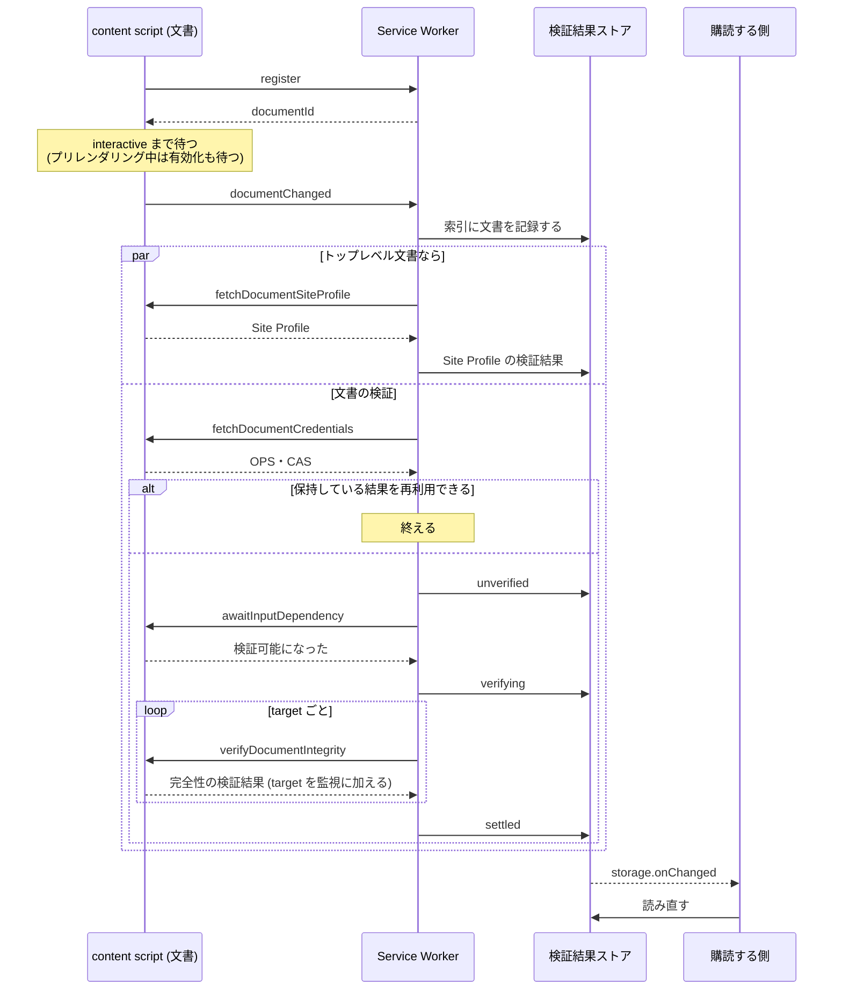
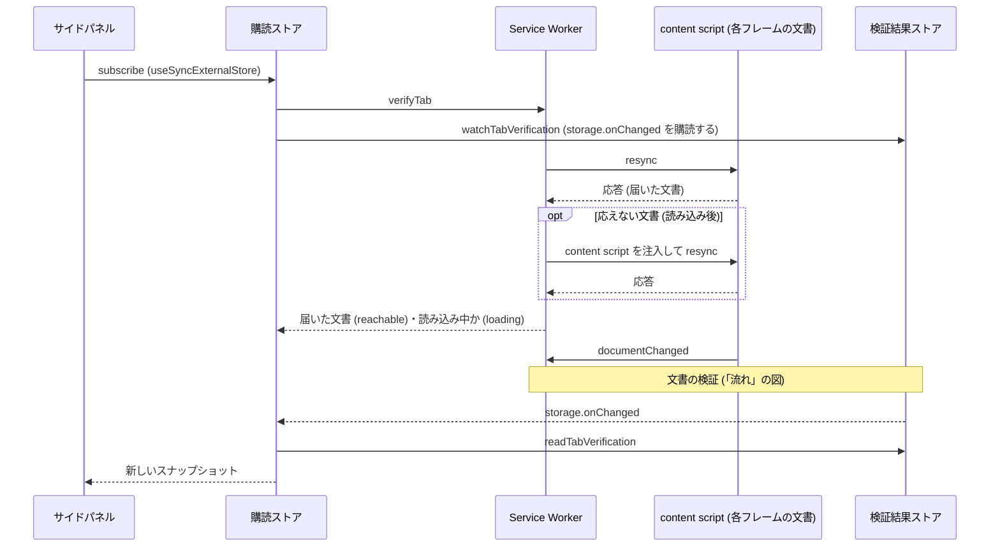

# verification

文書ごとに Service Worker が検証し、その結果を検証結果ストアに保持する

全フレームの content script がクレデンシャルの script 要素を検知して Service Worker
に知らせ、Service Worker が文書ごとに独立して取得・待ち合わせ・検証をおこなう。
結果は documentId をキーにして `chrome.storage.session` に置く。サイドパネル・
バッジ・リンク検証はストアを読むだけで、自分では検証しない。

## 流れ

1. content script が、文書の構文解析が終わった時点 (`interactive`) で
   `documentChanged` を送る。プリレンダリング中の文書は有効化を待ってから送る
2. Service Worker が文書を検証する ([background.ts](./background.ts) の
   `verifyFrameDocument`)
   1. フレームに読み込まれている文書を索引に記録し、入れ替わった文書の結果を破棄する
   2. トップレベル文書なら、Site Profile の取得と検証を並行して始める
   3. クレデンシャルを取得し、保持している結果を再利用できれば終える
   4. `unverified` を書き込み、入力依存対象が検証可能になるまで待つ
   5. `verifying` を書き込み、`verifyDocument` で検証して `settled` を書き込む
3. 購読する側が `storage.onChanged` を受けてストアを読み直す

検証は 1 つの文書について、レジストリと、その文書に設置された OPS を用いる。
トップレベル文書に限り、Site Profile の発信者も用いる。他の文書の OPS は用いない。

同じ文書の検証が重なったら、後から始めた検証だけが書き込む (世代で判定する)。
文書がフレームから外れていれば書き込めず、そこで検証を打ち切る。

## 文書とのやり取り

[events.ts](./events.ts) の `verificationMessenger` で送る。

| メッセージ                 | 向き    | 内容                                                   |
| -------------------------- | ------- | ------------------------------------------------------ |
| `register`                 | 文書→SW | 文書が自身の documentId を問い合わせる                 |
| `documentChanged`          | 文書→SW | クレデンシャルが変わった、または検証できる状態になった |
| `inputChanged`             | 文書→SW | 検証済みの target の入力依存対象が変化した             |
| `verifyTab`                | 画面→SW | タブ内の文書の検証を求める                             |
| `resync`                   | SW→文書 | `documentChanged` を送り直すよう求める                 |
| `fetchDocumentCredentials` | SW→文書 | クレデンシャルを取得する                               |
| `fetchDocumentSiteProfile` | SW→文書 | Site Profile を取得する                                |
| `awaitInputDependency`     | SW→文書 | 入力依存対象が検証可能になるまで待つ                   |
| `verifyDocumentIntegrity`  | SW→文書 | target の完全性を検証し、その target を監視に加える    |

Service Worker から文書へのメッセージは、宛先の documentId を添える。送信先は
フレーム単位でしか指定できず、別の文書に届くことがあるため、文書は自身の
documentId と一致しないメッセージを拒否する。documentId は `register` の応答
(Service Worker が受けた `sender.documentId`) で知る。

## 状態

文書ごとのエントリ (`VerificationEntry`) は 4 つの状態をとる。

| 状態          | 意味                                                          |
| ------------- | ------------------------------------------------------------- |
| `unverified`  | 検証を開始していない (入力依存対象を待っている)               |
| `verifying`   | 検証を開始したが結果が確定していない                          |
| `settled`     | 検証済みまたは検証失敗。どちらかは `result.status` で判別する |
| `invalidated` | 確定した結果が、入力の変化または時刻の経過で有効でなくなった  |

時刻の境界 (`result.validUntil`) を過ぎた結果は書き換えず、読み出すときに
`invalidated` として扱う ([identity.ts](./identity.ts) の `resolveEntry`)。
提示する側は、無効を検証失敗と区別する (`VerificationInvalidated`)。

Site Profile の検証結果 (`SiteProfileEntry`) は、トップレベル文書ごとに 1 度だけ
検証して保持する。再読み込みボタンで検証を求められたときは取得し直す。

## 入力依存対象の待ち合わせ

CAS の target の type から入力依存対象を求め、最も遅いものが検証可能になるまで待つ。
type と入力依存対象の対応は、仕様の定めるものを `@originator-profile/verify` の
`targetInputDependency` に置いている。

| 入力依存対象      | 待つ readiness | type                                         |
| ----------------- | -------------- | -------------------------------------------- |
| `response`        | `complete`     | `ExternalResourceTargetIntegrity`            |
| `parsed-dom`      | `interactive`  | `HtmlTargetIntegrity`, `TextTargetIntegrity` |
| `rendered-result` | `complete`     | `VisibleTextTargetIntegrity`                 |

`response` は本来、対象リソースの取得が終われば検証できる。リソースを個別に
追跡せず、文書の読み込み完了で近似している。

## 再利用と検証し直し

保持している結果は、次をすべて満たすときに再利用する
([identity.ts](./identity.ts) の `isReusable`)。

- `settled` で、時刻の境界を過ぎていない
- CAS・OPS の取得経路ごとのダイジェストと、target の入力依存対象が一致する
- allowedUrl の評価結果が、検証時の URL と現在の URL とで一致する

次の契機で検証し直す。

| 契機                                     | 送るもの                       | 再利用           |
| ---------------------------------------- | ------------------------------ | ---------------- |
| クレデンシャルの script 要素の挿入・削除 | `documentChanged`              | する             |
| 検証した target の要素の変化             | `inputChanged`                 | しない           |
| bfcache からの復元                       | `documentChanged` (`restored`) | 条件付き (※)     |
| サイドパネルを開いた・再読み込みボタン   | `verifyTab` → `resync`         | ボタンならしない |
| Service Worker の起動                    | 確定していない文書に `resync`  | する             |

※ 結果が `rendered-result` に依存していれば再利用しない。

same-document navigation で allowedUrl の評価結果が変わったら、検証し直さずに
`invalidated` を書き込む。

### target の監視

`verifyDocumentIntegrity` で検証した target の要素を、content script が監視する
([target-watcher.ts](./target-watcher.ts))。

- 要素の部分木の変化 (子・文字列・属性) と、要素が文書から取り除かれたことを検知する
- `rendered-result` に依存する target は、要素の大きさの変化も検知する
- 変化を 1 度検知したら監視を止め、次の検証で監視し直す

## 保持

| キー                                     | 値                                                   |
| ---------------------------------------- | ---------------------------------------------------- |
| `verification:document:<documentId>`     | 文書の検証の状態                                     |
| `verification:site-profile:<documentId>` | トップレベル文書の Site Profile の検証結果           |
| `verification:tab:<tabId>`               | タブの索引。フレームごとの文書と、bfcache にある文書 |

- フレームの文書が入れ替わったら、前の文書の結果を破棄する。前の文書が bfcache に
  あれば、復元されたときに再利用できるよう残す
- タブを閉じたら、そのタブの結果をすべて破棄する
- 索引の読み書きとエントリの書き込みは直列化する。索引にない文書の結果は書き込まない

## 購読する側

| 購読する側   | 使う関数                                                                           |
| ------------ | ---------------------------------------------------------------------------------- |
| サイドパネル | `tabVerificationStoreOf` (購読ストア)、`requestTabVerification` (再読み込みボタン) |
| バッジ       | `readTabVerification` (`storage.onChanged` を受けて)                               |
| リンク検証   | `waitForTabSiteProfile`                                                            |

`readTabVerification` は、`webNavigation.getAllFrames` が返すフレームの文書の結果
だけを返す。

サイドパネルは、タブごとの購読ストア ([subscription-store.ts](./subscription-store.ts))
を介して読む。購読ストアは検証結果ストアの変化を購読し、`useSyncExternalStore` に
渡せる形で提供する。検証を求めたときの到達確認の結果 (`reachable`・`loading`) を
加えるが、検証結果は保持せず、変化のたびに検証結果ストアから読み直す。

`verifyTab` はタブ内の全フレームに `resync` を送り、届いた文書を返す。読み込みを
終えても応えない文書には content script を注入して送り直す。

## 実装

| ファイル                                         | 役割                                                     |
| ------------------------------------------------ | -------------------------------------------------------- |
| [content-script.ts](./content-script.ts)         | 全フレームで検知・通知し、Service Worker の要求に応える  |
| [background.ts](./background.ts)                 | Service Worker の検証パイプライン                        |
| [store.ts](./store.ts)                           | 検証結果ストアとタブの索引                               |
| [identity.ts](./identity.ts)                     | 入力の同一性、再利用の判定、無効化                       |
| [credentials.ts](./credentials.ts)               | 文書から受け取ったクレデンシャルを取得経路付きの形に戻す |
| [target-watcher.ts](./target-watcher.ts)         | 検証した target の変化の監視                             |
| [tab-verification.ts](./tab-verification.ts)     | 購読する側が使う読み出し・購読・検証の要求               |
| [subscription-store.ts](./subscription-store.ts) | サイドパネルが使う購読ストアと到達確認                   |
| [types.ts](./types.ts)                           | エントリと結果の型                                       |
| [events.ts](./events.ts)                         | 拡張機能内メッセージ                                     |
| [errors.ts](./errors.ts)                         | 無効を表すエラー                                         |

アプリ側は `setupBackground` と `setupFrameHandlers` を呼ぶだけで、このモジュールを
直接は登録しない。

## 既知の限界

- target の監視は、検証時に選択された要素だけを対象にする。後から挿入されて
  セレクターに一致するようになった要素は検知しない
- `rendered-result` に依存する target について、ビューポートの大きさや文書の
  可視性の変化は検知しない
- Service Worker が停止すると、進行中の検証は失われる。起動したときに、確定して
  いない文書へ `resync` を送って検証をやり直す
